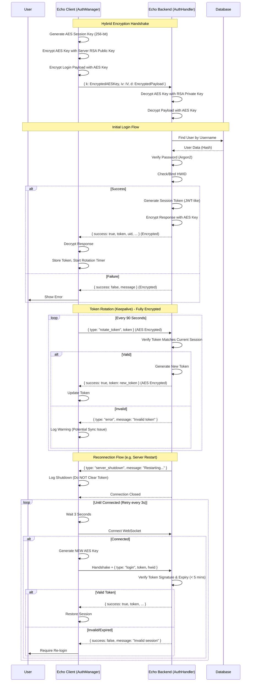
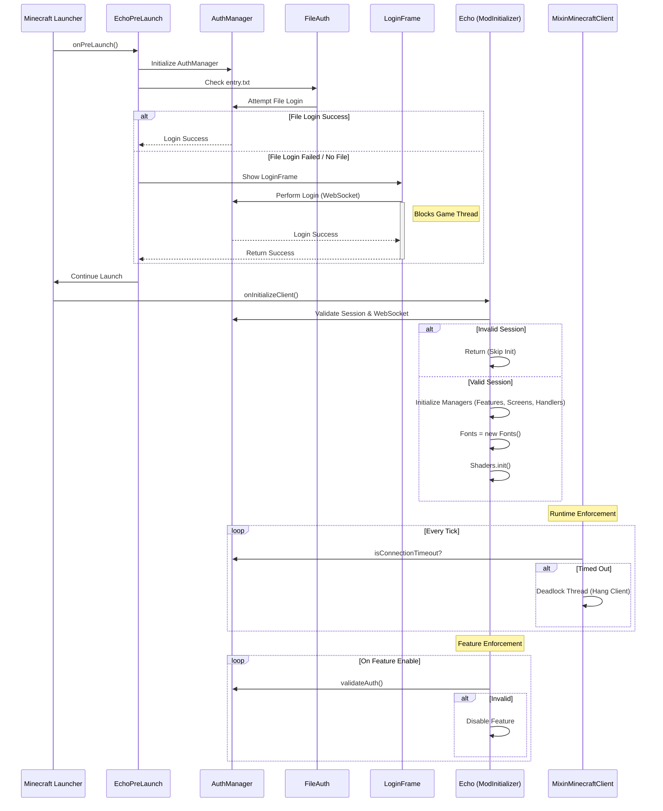

# Echo Authentication System Analysis ( Generated with AI, dont judge. It helps me keep track)

## Authentication Flow Diagram

## Security Analysis & Potential Flaws

### 1. Hybrid Encryption (Implemented)
- **Mechanism:** RSA (2048-bit) for initial key exchange, AES-256-GCM for all subsequent traffic.
- **Status:** ✅ **Secure**. Packet bodies are no longer plaintext.
- **Note:** While packet bodies are encrypted, using `wss://` (TLS) is still recommended for full transport layer security (integrity, authentication, hiding metadata).

### 2. Token Expiration vs. Rotation
- **Issue:** Tokens expire in 5 minutes. Rotation happens every 90 seconds.
- **Impact:** If a user loses connection for more than 5 minutes, their "resume session" token becomes invalid, forcing a manual re-login. This is a trade-off between security (short-lived tokens) and convenience.
- **Observation:** The server validates tokens based on signature and timestamp, not by checking a database of "active" tokens. This is stateless verification, which is good for performance but means *any* valid token generated in the last 5 minutes works, even if a newer one was generated (though the client overwrites it).

### 3. Custom Token Implementation
- **Issue:** The system uses a custom `uid.timestamp.random.signature` format instead of standard JWT (JSON Web Tokens).
- **Impact:** While the HMAC-SHA256 signature is secure *if* implemented correctly, custom crypto is prone to subtle implementation errors (e.g., timing attacks, weak randomness).
- **Recommendation:** Consider using a standard JWT library to ensure robust security practices.

### 4. Client-Side Trust
- **Issue:** The client has logic like `validateSession()` and `isFullyAuthenticated()`.
- **Impact:** A malicious user can modify the client code (bytecode manipulation) to bypass these checks and enable features without actually being logged in, *unless* the server actively validates every action.
- **Mitigation:** Ensure the server validates authentication for *every* sensitive action (e.g., sending chat messages, accessing protected data) and doesn't just rely on the client saying "I'm logged in".

### 5. HWID Binding
- **Issue:** HWID is bound on first login.
- **Mechanism:** The client generates a SHA-256 hash of `PROCESSOR_IDENTIFIER` + `COMPUTERNAME` + `"EC"` + `user.name`.
- **Impact:** Legitimate users changing hardware will be locked out and require admin intervention to reset HWID.
- **Recommendation:** Implement an admin tool or automated process for HWID resets if this is a frequent issue.

### 6. Rate Limiting
- **Issue:** Rate limiting is implemented but could potentially be bypassed if IP/HWID spoofing is possible, though it provides a basic layer of defense against brute-force attacks.

## Client Initialization & Auth Enforcement

### Initialization Flow
The client enforces authentication *before* the game fully loads, using a "Pre-Launch" entrypoint.

### Security Mechanisms
1.  **Pre-Launch Blocking:** The `EchoPreLaunch` class implements `PreLaunchEntrypoint`. It opens a Swing window (`LoginFrame`) and **blocks the main thread** until a successful login occurs. If login fails or the window is closed, `System.exit(0)` is called, preventing the game from starting.
2.  **Runtime Deadlock:** `MixinMinecraftClient.java` injects into the main game loop (`tick`). It checks `AuthManager.isConnectionTimeout()` (3 minutes without server response). If timed out, it intentionally **deadlocks the client** using `lock.wait()`, effectively freezing the game to prevent unauthorized usage.
3.  **Initialization Gate:** `Echo.java` verifies the session state before initializing core components. Crucially, **Fonts** (`new Fonts()`) and **Shaders** are only initialized if authentication passes. Without fonts, the UI would likely be unusable or crash.
4.  **Feature-Level Enforcement:** Every `Feature` (module) checks `validateAuth()` in its `onEnable()` method. If the session is invalid, expired, or the UID is missing, the feature **automatically disables itself** and refuses to register with the event bus, rendering it non-functional.

### WebSocket Dependencies
The client relies on a persistent WebSocket connection (`ws://localhost:8080`) for:
*   **Initial Login:** Sending credentials and receiving the session token.
*   **Token Rotation:** Rotating the session token every 90 seconds to prove liveness.
*   **Server Commands:** Listening for `kick` or `broadcast` messages from the server.
*   **Connection Validation:** The client checks `webSocket.isOutputClosed()` to ensure the connection is alive.
